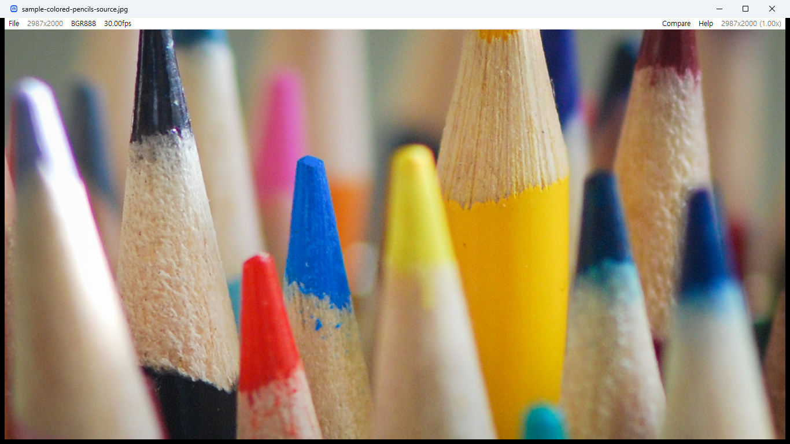
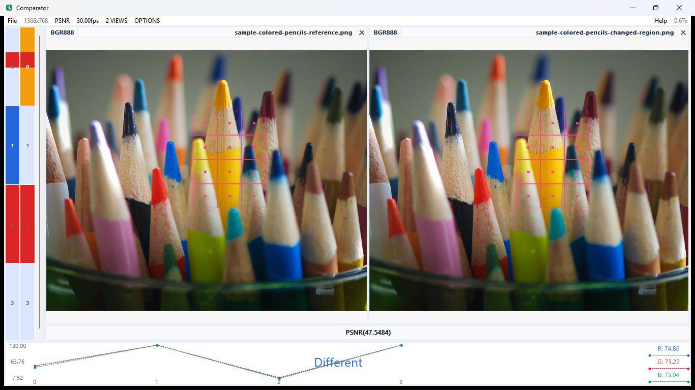

# Q1View User Guide

Q1View contains two focused Windows applications: **Viewer** for inspecting a
single source and **Comparator** for measuring differences between sources.

## Viewer

Viewer opens regular images, raw frame dumps, image sequences, videos, and
clipboard images. The top bar reports resolution, interpreted color space, and
frame rate; high zoom reveals per-pixel component values. For timed sources,
the bottom progress bar shows both the frame counter and playback time.

### Typical Workflow

1. Open or drag a source into Viewer.
2. Use the mouse wheel to examine edges and individual pixels.
3. Use `C`, `B`, `Y`, `H`, or `I` to adjust inspection overlays and display.
4. For video, use `Space`, arrow keys, the timeline, and the FPS menu.
5. Select **Compare** to move a source into comparison work.

Video playback follows the source FPS or the FPS chosen in the menu. When FPS
timing is known, the progress bar shows current time and total duration in a
compact one-decimal format such as `00:01.2 / 00:10.0`; if timing is missing or
invalid, Viewer keeps the frame-only readout. If display or decode work briefly
falls behind, Viewer drops late presentation frames to return to the media
timeline.

When a raw YUV source is zoomed far enough to show pixel values, Viewer shows
source-native `Y`, `U`, and `V` values by default. They are sampled from the
planes in the selected raw layout, including subsampled and 10-bit formats,
rather than reconstructed from the displayed RGB image. Press `V` to toggle
between source YUV values and displayed RGB values. A small corner badge
identifies the active pixel-value mode and row order (`Y/U/V` or `R/G/B`)
without adding labels to every pixel.
Decoded images and video show RGB values only.

### Windows Viewer commands and status

The top menu keeps **File, resolution, pixel format, FPS, Options, Browse**, followed by the right-aligned **Compare, Help, Fit, 100%** group. **Fit** and **100%** are the two far-right commands. Open files through **File → Open** or **Ctrl+O**, without a duplicate top-level Open button. **Browse** toggles the same thumbnail drawer as `E`. **Fit** shows the whole image without enlarging small images; **100%** switches to manual actual-pixel size. The active Browse/Fit/100% state is highlighted. Fit/100% require a valid displayed frame, but **Compare** is always available and can open an empty Comparator workspace.

Menus use measured text widths at the current DPI and Windows text size, wrapping into additional rows when necessary rather than hiding commands or reducing font size. Resolution, pixel format and FPS remain directly visible as before; fixed decoded sources keep RAW-only settings unavailable. Image scaling, theme, Fit and actual-size commands are grouped in **Options**, with no separate **View** or **More** menu. Existing Alt menu access and shortcuts remain available. Windows high-contrast/non-DWM fallback retains the OS-managed native menu.

The bottom status line is read-only: image dimensions, the active input/conversion pixel format (for example, a decoded photo is BGR888, not its original JPEG storage format), actual zoom percentage, Fit/Manual view mode, sampling mode, and the displayed frame position when there is more than one frame. Empty input shows **Ready**, not the default RAW dimensions as if an image were loaded. Long status text uses an ellipsis; hover for the full text, also exposed through the native accessibility name. Status updates do not resize the image area or move command buttons. Full screen hides both command and status areas.

### Image Scaling

Choose **Options → Image Scaling** in Windows Viewer (**View → Image Scaling** in Qt) or press `I` to cycle through **Auto**, **Smooth (Bilinear)**, and **Pixel Exact (Nearest)**. Auto uses bilinear sampling for moderate still-image reductions so thin document text remains legible, area sampling for reductions of 2x or more to suppress aliasing in large photos, and nearest sampling for pixel inspection and timed sources. The active choice appears in the read-only Windows status line and in the Qt status bar; at high zoom, `Auto→Pixel` confirms that Auto is displaying exact source pixels.

### Theme (Windows Viewer and Comparator)

In Viewer choose **Options → Theme**. This is the shared theme for both Viewer and Comparator; Comparator has no separate theme menu. **System** is the default and follows the Windows app theme. **Light** applies bright application colors and a light gray image surround (`#ECECEC`); **Dark** applies dark application colors and a dark gray image surround (`#181818`). One selection updates titles, application menus, panels, help, text, selection, metric graph colors and the exposed background around images together, including other running instances, without reopening sources or resetting zoom, pan, ROI, playback or comparison results. To change the theme while using Comparator alone, open Viewer. Viewer's **Options** also contains image-scaling controls, and Comparator retains its comparison-specific Options. Comparator's Timeline scrollbar matches the application palette, reverting to native rendering in Windows high contrast. Windows-owned file dialogs, system menus, other native scrollbars and popup chrome retain their OS appearance.

The Timeline scrollbar appears only when video frame rows overflow the panel, not for empty or still-image comparisons. Scroll with the wheel, arrow/page buttons or thumb drag; when the Timeline or scrollbar has focus, Up/Down, Page Up/Page Down and Home/End scroll its list without seeking the source media. Clicking a frame row still selects that frame, and the Timeline's existing Space and Left/Right playback shortcuts remain available.

Theme changes do not tint image pixels or alter color conversion, captured regions or metric inputs. Both applications use one saved preference, even when Comparator starts without Viewer running. Viewer imports its earlier theme on first use if no shared choice exists; Comparator's old independent theme and earlier separate image-background values are ignored. In Windows high-contrast mode, system colors take priority; the saved theme remains available when high contrast is turned off. These settings apply only to the Windows applications, not the Qt viewer.

### Controls

Windows command availability follows the same rules in menus, keyboard command handlers and contextual help. Viewer RAW resolution/color-space controls are available for RAW inputs and empty-session setup, but not for decoded images or videos. Copy needs presented image pixels; Paste needs a supported image on the clipboard. The main Compare command is always available: with an open file it passes that file to Comparator, and without one it opens an empty Comparator workspace. The browser's separate Compare selected files command still applies to its own selection. Unavailable commands do not execute through alternate entry points.

In Comparator, each source's format menu is a native keyboard-accessible button for RAW input; decoded-source format buttons are disabled and read-only filenames are not buttons. Tab from an eligible source canvas focuses its format button, Space/Enter opens it, and Tab returns to the canvas. Normal, hover and pressed states differ; keyboard focus has a visible outline, while unavailable commands use muted text without an extra dashed outline. Native Alt menus and Windows high-contrast behavior are retained. This does not add a new toolbar or change global shortcut routing.

In Windows Viewer, Options > Autoplay Videos When Opened applies both to opening a video directly and to moving to another file with Page Up/Page Down. With the option enabled, the next or previous video starts after its first frame is presented; with it disabled, the video waits at its first frame. File navigation keeps the current outer window size. Internal reloads and rotating a paused video do not start autoplay, and still images never autoplay.

Viewer includes a built-in control panel, opened with `?`.

In the Windows Viewer and Comparator, window titles, help descriptions and main application menus share the Pretendard UI font. Titles and menus use normal-weight 14 DIP text; the custom main-menu row and dropdown rows provide at least 32 DIP height, follow Windows text enlargement and wrap the main-menu buttons when the window is narrow. Windows still draws and operates the minimize, maximize/restore and close buttons. Drag or double-click the title to move or maximize the window, right-click it or press Alt+Space for the Windows system menu, and use F10 or Alt to access application menus. Alt mnemonics, arrow-key navigation, check/radio states and command shortcuts remain available. Menu buttons expose accessible names and retain their original popup commands. Viewer full-screen mode hides the title and menu, then restores the same menu when leaving full screen. High-contrast mode or unavailable DWM composition uses the native Windows frame instead. Shortcut columns in help are measured rather than aligned with spaces, and descriptions wrap when needed. If the panel overflows, use the mouse wheel, Up/Down, Page Up/Page Down, or Home/End to read it; these navigation keys operate on help while it is open instead of changing the underlying image. Click the panel or press Esc to close it. Numeric inspection values retain a monospaced font; system menus, other context menus and Windows dialogs retain native typography.

| Action | Control |
| --- | --- |
| Open a file | Drag and drop or `Ctrl+O` |
| Toggle thumbnail browser (drawer) | `E` |
| Paste image from clipboard | `Ctrl+V` |
| Zoom | Mouse wheel |
| Enter or exit full screen | `Return` |
| Exit full screen | `Esc` |
| Play or pause video | `Space` |
| Previous or next frame | Left / Right |
| First or last frame | Home / End |
| Previous or next file | Page Up / Page Down |
| Toggle luma-only view | `Y` |
| Toggle RGB / source YUV pixel values | `V` |
| Toggle hex pixel values | `H` |
| Rotate clockwise | `R` |
| Toggle pixel coordinates | `C` |
| Toggle box info display | `B` |
| Cycle scaling: Auto → Smooth → Pixel Exact | `I` |
| Next color space | `N` |
| Next preset resolution (raw input) | `D` |
| Mute or unmute video audio | `M` |
| Toggle selection mode | `S` |
| Capture view or selected region | `Ctrl+C` |

### Thumbnail Browser

Press `E` (or **File ▸ Thumbnail Browser**) to slide out a thumbnail drawer on
the left. It is hidden by default, so the window is unchanged until you open
it. The compact list is a complete view of the current folder, with thumbnails
or labeled placeholders as appropriate. In the Windows Viewer, Ctrl+wheel over
the drawer changes to gallery grids that keep folders and useful image/video
previews while hiding documents, archives, raw files, and videos whose preview
cannot be extracted. A damaged supported image remains visible with a restrained
preview-unavailable badge. Double-click a file to open it in the main view. The
drawer's visibility and thumbnail size are remembered between sessions.

Right-click a single file for **Open**, **Copy** (a real file clipboard item), **Copy full path**, **Copy file name**, **Show in File Explorer**, **Properties**, or **Move to Recycle Bin**. Folder menus offer **Open folder**, file/path copy, Explorer, and properties. On non-Windows Qt, **Open containing folder** replaces Explorer and the Windows properties command is hidden.

In the Windows compact list and gallery grid, Ctrl+click toggles individual media files, Shift+click selects a range, and Ctrl+A selects all visible media files. With two to four media files selected, right-click the selection and choose **Compare selected files** to open Comparator; with more than four selected, Compare is hidden. Individual-file commands are hidden while multiple files are selected. Choose **Move N items to Recycle Bin** (or press Delete) to recycle a batch; on non-Windows Qt, the action is **Move to Trash**. Review the count and confirm before anything moves. Parent and directory entries cannot be included; documents shown in the compact list are not deletion targets. Shift+Delete does not permanently delete files. If the active photo or video is moved, the Viewer opens the next surviving media file, or the previous one if it was last. Items that could not be moved remain in the folder and are reported.

The Windows drawer watches its current directory and refreshes after files or folders are added, removed, or renamed. Existing selections are retained when their files still exist; PgUp/PgDn and the drawer therefore use the same updated folder contents.

The first entry is **[..]** in every non-empty folder, including a drive or UNC share root. In a drive/share root, activating **[..]** opens the top-level logical-drive chooser; select `[C:\]`, `[D:\]`, or another listed volume to switch drives. Child directories use the same compact **[Folder name]** notation, accent color, and medium-weight Pretendard text in both Viewer implementations, without a decorative folder picture. Double-click the parent entry or press Enter to move upward. With focus in the drawer, **Backspace** and **Alt+Up** remain keyboard shortcuts for the same action. Going upward retains the thumbnail size and selects/reveals the folder you just left. Folder browsing does not open or seek media, resize the window, or broadcast synchronized playback changes. Missing/unavailable folders leave the existing drawer unchanged. Rename, cut, paste, and moving directories are not part of these actions.

In the Windows Viewer, opening or closing the docked drawer changes the image viewport in one stable layout pass. Fit-to-window images are refitted and centered in the remaining viewport (small images stay at 100%); manually zoomed or panned images retain their zoom and inspected screen position. Closing the drawer returns keyboard focus to the image view.

### Synchronized Viewer Windows

To inspect related sources interactively, open more than one Viewer window,
right-click each image area, and enable **Sync Input**. Navigation, zoom, pan,
rotation, playback, FPS, and display mode changes are relayed between enabled
Viewer windows.

## Comparator

Comparator opens two to four images, raw dumps, or video/frame sources in aligned
panes. The header controls the interpreted resolution, metric, FPS, view count,
and options.

### Typical Workflow

1. Open multiple files together or drop a source into each pane.
2. Treat pane **A** as the fixed reference; B, C, and D are separate candidates. Select **PSNR**, **SSIM**, or either **LPIPS** backend from the metric menu.
3. Zoom and navigate the sources in a common view.
4. Use the bottom graph and channel values to find meaningful differences.
5. Enable **Allow Different Resolution** from **OPTIONS** when required.

The same reference and encoded image can also be reviewed with SSIM selected.
When multiple selected files are members of the same discovered image sequence,
Comparator treats those selections as explicit single-image panes, so `0.jpg`
versus `1.jpg` compares the two chosen files instead of seeking two offsets in
one sequence.

### Pixel-Level Diff Overlay

When sources are loaded, Comparator highlights every region where the pixels
differ from the reference pane. The image area is divided into a fixed-size
grid in display pixels; each cell that contains any differing pixel gets a
translucent pink rectangle outline plus a center dot. Because the cell size is
fixed on screen, zooming in implicitly subdivides the source area each cell
covers — at maximum zoom each dot resolves to a single differing source pixel.
The overlay is hidden automatically when zoom is high enough to show per-pixel
values, since the pixel labels already convey the diff.

Each candidate's overlay compares against A. A's overlay shows the active comparison, initially A/B; click a result card or its graph to inspect A/C or A/D instead. This changes the inspected pair, not the reference or which pairs are calculated.

### Pane Layout

Three secondary panes sit around the image canvases and surface per-frame and
across-frame comparison information.

- **Timeline (left column).** One lane per loaded source, with a shared frame-number gutter and sticky A/B/C/D headers. Click a lane to seek that source independently; click the gutter to seek all sources that have the requested frame. Missing lane frames are marked with a dash and cannot be selected. Difference lines in A describe the active pair; each candidate's lane describes its comparison against A. Space/Left/Right retain playback controls, and the themed scrollbar is shown only for real overflow.

- **Current comparison footers.** A's image has a non-interactive **Reference** label and its actual frame number underneath. B, C, and D each show their own A/B, A/C, or A/D comparison directly below the corresponding image, even after resizing columns or closing another source. Footers identify actual displayed frame numbers, metric units, ROI scores, and necessary warnings without repeating source filenames or showing the calculation-basis annotation. RGB's existing aggregate score remains the default result; hover a result for its comparison basis, channel scores, full source paths, and resolutions. Channel curves and averages remain in the separate sequence graphs. Independently seeking C to frame 12 while A shows frame 10 measures A10/C12, not the cached aligned frame 10, and displays **Unaligned: frame indices differ**. Seeking or reloading only C refreshes A/C while keeping completed A/B and A/D current/ROI results visible and unchanged. Moving A, changing the metric, or changing the shared ROI refreshes all affected pairs. In narrow windows, results stay in their image columns and use wrapped text and vertical scrolling; Tab moves between available results and Enter selects the inspected pair. If A is closed, remaining results ask for reference A instead of promoting another source.

- **Sequence analysis (bottom strip).** Each pair has its own graph, computed count, average and status. All graphs share the frame-index viewport and selected metric's finite Y scale. Mouse-wheel over a plot zooms without seeking; double-click resets the shared range. Clicking a plot seeks all sources that actually have that frame. A graph ends at the shorter of its two sources, even if another source extends Timeline farther. Infinity has an explicit marker; uncomputed and missing samples are gaps, not zeros. Graphs stack in narrow windows, with a themed scrollbar, and can be collapsed without clearing caches. Stills show single-frame results rather than fabricated temporal curves.

Comparisons are frame-index based, not timestamp aligned. Different FPS is called out on the cards; Comparator does not resample sources. Closing B or C does not rename the remaining slots. Closing A clears numerical comparisons and asks for a reference instead of silently promoting another source.

### Controls

Comparator also includes a built-in shortcut panel, opened with `?`.

| Action | Control |
| --- | --- |
| Show or hide the shortcut panel | `?` |
| Open a source in a pane | Drag and drop |
| Zoom | Mouse wheel |
| Previous or next video frame | Left / Right |
| Play or pause | `Space` |
| Toggle hex pixel values | `H` |
| Toggle pixel interpolation | `I` |
| Toggle pink diff overlay (grid + dots) | `D` |
| Toggle cursor pixel coordinates | `C` |
| Seek one source to a Timeline frame | Click its A/B/C/D lane |
| Seek available sources to a Timeline frame | Click the shared frame-number gutter or a graph |
| Select the inspected reference pair | Click its result card; Tab / Enter also work |

## Input Notes

- HEIF/HEIC/HIF and AVIF still images are supported by both applications.
- Linear YUV raw inputs support odd dimensions such as `321x241`, with the
  resolution and color-space token supplied in the file name.
- The portable package and installer include the required runtime libraries.
- Unicode paths are supported, including Korean file and directory names.
- Video decoding depends on the codecs supported by the bundled OpenCV/FFmpeg
  runtime.
